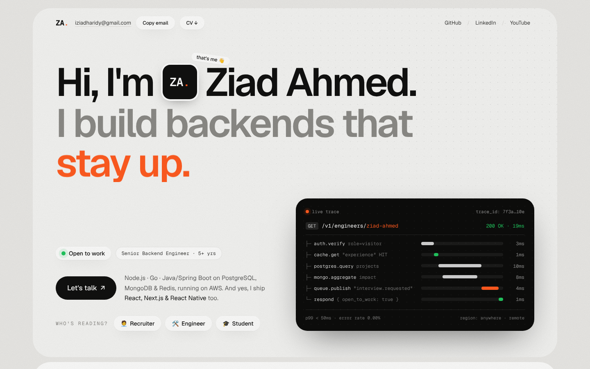
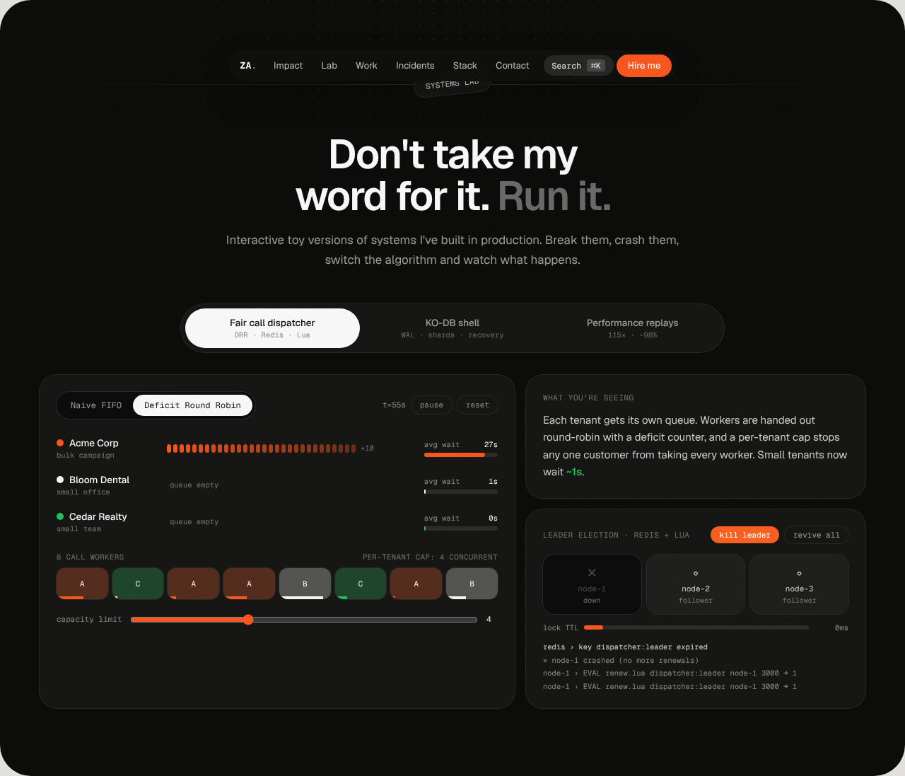

# Ziad Ahmed — Portfolio

A portfolio for a senior software engineer: it shows the work running instead of just describing it.

**Stack:** Next.js 16 (App Router, static export) · React 19 · TypeScript · Tailwind CSS v4 · Motion · Geist / Geist Mono

## What's inside

| Section | Hook |
| --- | --- |
| **Hero** | Rotating headline, "Open to work", and a **live distributed-trace waterfall** (`GET /v1/engineers/ziad-ahmed`) |
| **"Who's reading?" lens** | Recruiter / Engineer / Student buttons. Each one shows a tailored panel (30-sec summary + CV, systems-lab pointer, student corner), and the trace's `role=` changes with it |
| **Benchmarks** | Partner-logo marquee of the companies Ziad has worked with, plus count-up production metrics: 115×, −98%, 140×, ~$2K/yr, 153 APIs, 804 → 1 |
| **Infrastructure** | The production AWS + Cloudflare setup of the booking startup as a live diagram: real request flows (booking, ID upload, photos, email bounces, deploys, admin sign-in) play on a loop, with narration; data in `content/infra.ts`, icons in `public/infra/` |
| **About (bento)** | Experience timeline, live local time (Egypt), education, a five-book bookshelf, "How I work" stepper |
| **Systems Lab** | Interactive demos: **Deficit Round Robin vs FIFO call dispatcher** with **Redis/Lua leader election** (kill the leader), a **KO-DB shell** (SET/GET/DEL, CRASH → WAL replay, sharding), and **performance replays** (COLLSCAN vs IXSCAN race, buffered vs re-architected export memory) |
| **Selected work** | The four best systems only (healthcare AI, CRM on Spring Cloud, AI voice agent, KO-DB), as accordion case studies with architecture diagrams that use real tech logos |
| **Achievements** | Every win in one place: 52 achievements, filterable by Performance, Reliability, Security, Cost & cloud, Built, Leadership and Awards & learning. Shows the top 9 first (6 on phones) |
| **Recommendation** | Signed letter from the CEO of Solid Ground Solutions: pull quote, a thumbnail that opens the full letter, and a PDF download (`public/letters/`) |
| **Postmortems** | Status-page style history of the four biggest incidents (region evacuation, leaked key, RDS outage…); the rest live in Achievements |
| **Stack / Student corner / FAQ / Contact** | Filterable skills, a compact TA corner with a backend roadmap, a four-question recruiter FAQ, Email / WhatsApp / LinkedIn |
| **Navigation** | Floating nav on desktop; on phones and tablets a **burger menu** opens a full-screen sheet with numbered sections, Email / CV and socials |
| **Extras** | `⌘K` command palette, a real static API at **`/api/profile.json`**, a devtools console greeting, JSON-LD for SEO, an Open Graph share image (`public/og.png`), `prefers-reduced-motion` support |

## Run it

```bash
npm install
npm run dev        # http://localhost:3000
npm run build      # static site in ./out
```

## Edit the content

Everything lives in **`content/profile.ts`**: copy, metrics, experience, projects, incidents, achievements, stack and FAQ. Set `featured: true` on a project or incident to show it in the main sections, and `top: true` on an achievement to pin it to the first screen. `/api/profile.json` is generated from the same file.

- **Photo:** replace `public/ziad.jpg` (square). Set `photo: ""` in `content/profile.ts` to show the ZA monogram instead.
- **CV:** replace `public/Ziad_Ahmed_CV.pdf`.
- **Domain:** the site is set up for **https://ziad-dev.com** (`metadataBase` in `app/layout.tsx`, used for canonical and OG/Twitter cards).

## Deploy

It's a fully static export (`out/`), so any static host works.

### Cloudflare Pages (domain is on Cloudflare)

1. Push this folder to a GitHub repo.
2. Cloudflare dashboard → **Workers & Pages** → **Create** → **Pages** → **Connect to Git** → pick the repo.
3. Build settings: framework preset **Next.js (Static HTML Export)** (or *None*), build command `npm run build`, output directory `out`. Add the environment variable `NODE_VERSION` = `22`.
4. **Save and Deploy** → you get a `*.pages.dev` URL.
5. Project → **Custom domains** → add `ziad-dev.com`, then `www.ziad-dev.com`. Cloudflare creates the DNS records and the HTTPS certificate automatically.

Every push to `main` redeploys.

### Vercel / Netlify

- **Vercel:** import the repo (no config). If the domain stays on Cloudflare DNS, add the records Vercel shows with the proxy **off** (grey cloud).
- **Netlify:** build `npm run build`, publish `out`.

## Brand: ZA signature

`public/brand/` holds the ZA monogram, Ziad's mark and digital signature:

- `za-mark.svg` / `za-mark-white.svg`: full colour on light / dark
- `za-mark-mono-black.svg` / `za-mark-mono-white.svg`: single colour (stamps, embossing, docs)
- `za-lockup.svg` / `za-lockup-white.svg`: mark + name + role (email signature, CV header, slides)
- `za-icon.svg`, `za-icon-512.png`: app icon / favicon; `za-avatar-1024.png`: profile picture
- PNG exports at 1200px for places that don't take SVG

Construction: the Z is three sheared blocks split by parallel slits; the A is a slanted leg cut against a straight stem; every diagonal shares one angle (1 : 2, about 26.6° from vertical). The orange `#ff5a1f` dot is the A's crossbar and the signature "period". Keep clear space equal to the dot's diameter × 2 around the mark; minimum size 16px tall (mark) / 24px tall (lockup). In code, use `components/ui/Logo.tsx`.

## Design

The Figma file **portfolio** has matching foundations (color variables, Geist text styles, components) plus Desktop 1440 and Mobile 390 pages.

## Screenshots




## Credits

Technology logos in `public/tech/` come from [Devicon](https://devicon.dev) (MIT), [Simple Icons](https://simpleicons.org) (CC0) and the [AWS Architecture Icons](https://aws.amazon.com/architecture/icons/) via the `aws-icons` package (MIT). Logos are trademarks of their owners. Company logos in `public/logos/` belong to their respective companies.
